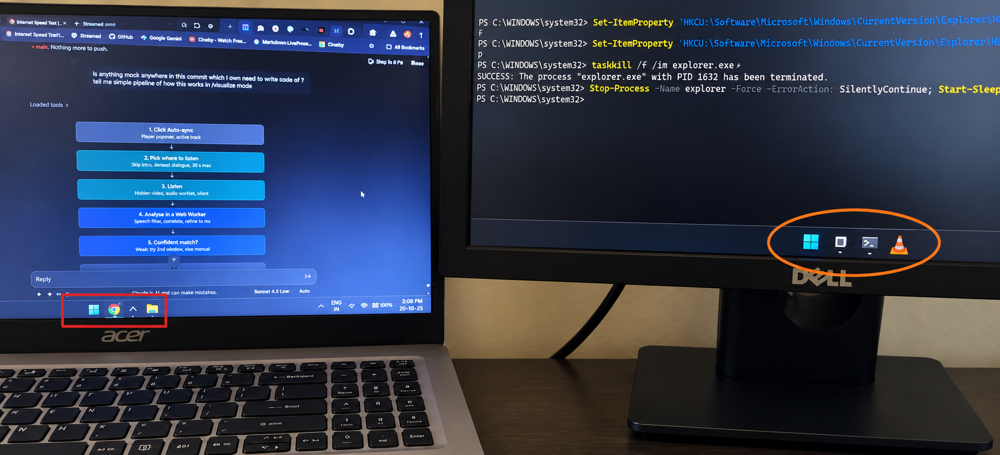

# Dual Monitor Taskbar Fix

**Make each monitor's Windows 11 taskbar show only the windows that are actually
on that monitor.**



> Left (Acer laptop): Chrome and File Explorer — on the laptop screen, on the laptop taskbar only.  
> Right (Dell): Terminal and VLC — on the external screen, on the Dell taskbar only.  
> PowerShell in the background shows the fix being applied.

## What is wrong

Windows 11 has this feature. It is off by default.

With two displays in extended mode, a stock Windows 11 taskbar shows **every**
window's button on **every** taskbar. The same set of buttons on both. So a
button never appears to leave the monitor it came from: it is still on the old
taskbar *and* the new one. People write this up as "the taskbar button does not
follow the window between monitors".

The fix is a setting. Windows ships it, and it is one registry value:

```
HKCU\Software\Microsoft\Windows\CurrentVersion\Explorer\Advanced
    MMTaskbarMode   (REG_DWORD)

    0   All taskbars                                        <- the default
    1   Main taskbar and taskbar where window is open
    2   Taskbar where window is open                        <- what most people want
```

## The three commands

```powershell
# look
Get-ItemProperty 'HKCU:\Software\Microsoft\Windows\CurrentVersion\Explorer\Advanced' -Name MMTaskbarMode

# set
Set-ItemProperty 'HKCU:\Software\Microsoft\Windows\CurrentVersion\Explorer\Advanced' -Name MMTaskbarMode -Value 2 -Type DWord

Stop-Process -Name explorer -Force -ErrorAction SilentlyContinue; Start-Sleep -Seconds 2; Start-Process explorer.exe
```

The third line restarts Explorer, because the shell reads the setting when
Explorer starts. Explorer comes straight back.

## Revert

```powershell
# back to the Windows default
Set-ItemProperty 'HKCU:\Software\Microsoft\Windows\CurrentVersion\Explorer\Advanced' -Name MMTaskbarMode -Value 0 -Type DWord

Stop-Process -Name explorer -Force -ErrorAction SilentlyContinue; Start-Sleep -Seconds 2; Start-Process explorer.exe
```

Or use the Settings app, which has the same three options as a dropdown:

```
Settings
  -> Personalization
  -> Taskbar
  -> Taskbar behaviors
  -> "When using multiple displays, show my taskbar apps on"
```

## Or one command, if you would rather not touch the registry by hand

```powershell
npx dual-monitor-taskbar-fix --apply     # switch to "taskbar where window is open"
npx dual-monitor-taskbar-fix --reset     # put the previous value back
npx dual-monitor-taskbar-fix --status    # report the current mode
```

The package is in `npm/`. It needs no administrator rights, no dependencies,
and no network access beyond fetching itself. It saves the previous value to
`~/.dualmonitortaskbarfix-backup.json` before changing anything, so `--reset`
restores exactly what was there.

## Result

With mode 2, each taskbar shows only the windows on its own monitor, and buttons
follow windows as they are dragged between displays. Verified on the reference
machine, which has a 125% laptop panel and a 100% external display:

```
Shell_TrayWnd          [Start | Snipping Tool pinned | Google Chrome - 1 running window | Terminal - 1 running window | ...tray...]
Shell_SecondaryTrayWnd [Start | OpenCode - 1 running window | Clock]
```

Chrome and Terminal are on the laptop screen, so they are on the primary taskbar
only. OpenCode is on the external screen, so it is on the secondary taskbar only.

---

## How we got here

The rest of this document is the investigation. Read it if you want to know why
the fix is a setting and not a patch, and how the setting was found, because
the obvious answer is wrong.

### The obvious answer is wrong

There is a registry value called `ProgrammableTaskbarStatus`. It reads `2` on
machines that show the problem. Its name, and the fact that it is already set
correctly, makes it look like the setting that governs this behaviour.

It is not. It is a different setting. Following that name is how the research
this project started from went looking for a shell bug that was never there.

### What we did instead

We reverse-engineered the Windows 11 taskbar to find out what was actually
happening. A summary of the trail, with the full record in
`docs/analysis/`:

1. Built a PE inspector, an x64 cross-reference scanner, a Ghidra export
   pipeline and a Frida tracer.
2. Decompiled `Taskbar.dll` (11,219 functions) and `explorer.exe` (7,815
   functions) and mapped the placement decision chain in the taskband.
3. Traced a window being dragged across the boundary and concluded the shell had
   no window-move trigger at all.
4. Built a working `explorer.exe` injector that reaches the shell's own
   re-evaluation path, to fix it.
5. Then listed the actual taskbar contents through UI Automation, and saw the
   button duplicated on both taskbars. That is not a placement bug. That is the
   "All taskbars" mode, and it had been true the whole time.
6. Drove the Settings dropdown with UI Automation and diffed the registry. The
   answer: `MMTaskbarMode`.

### What we got wrong, and why it matters

The trace in step 3 was invalid. The probe window was created by a script, so
the shell never gave it a taskbar button, so there was nothing to re-evaluate,
so the placement code correctly did not run. We read "does not run for a window
the shell does not track" as "never runs on a move", and built a shell injector
on top of it.

Two things we would do differently:

* **Get the observable behaviour first.** One UI Automation query, printing
  what is really on the taskbars, would have shown the duplication immediately.
  We spent hours reasoning about placement logic while the cheapest experiment
  available sat unused.
* **Check the configuration layer before the implementation layer.** Every OS
  feature has a setting, and this symptom was a mode, not a bug.

### Why the project still has 38 files

The fix is one value. The finding was the hard part, and the tooling is what
makes the finding reproducible instead of folklore:

| file | what it is for |
|---|---|
| `npm/bin/dual-monitor-taskbar-fix.js` | the shipped tool |
| `experimental/scripts/set_taskbar_mode.ps1` | drives the Settings dropdown and diffs the registry. This is **how the value name was found**. Without it, `MMTaskbarMode` is a magic string nobody can re-derive on a future Windows build |
| `experimental/scripts/taskbar_buttons.ps1` | lists the real taskbar contents through UI Automation. This is **how the fix was verified** |
| `experimental/scripts/peinfo.py`, `xrefs.py`, `aobgen.py`, `grepdec.py` | the PE and Ghidra toolchain |
| `experimental/injector/` | the shell injector. It works, and it is **not needed**. Kept as the evidence, clearly labelled |
| `docs/analysis/` | the full record, including the wrong turns |

The one piece of raw evidence is in `docs/analysis/evidence/`, a Frida trace
showing the placement code not running for an untracked window.

## Repository layout

```
npm/                    the Node CLI, publishable as dual-monitor-taskbar-fix
docs/analysis/          the investigation, including the wrong turns
experimental/            research tooling, not part of the fix
original/bin/           shell binaries copied off the running system (gitignored)
v1/analysis/            Ghidra output (gitignored, regenerable)
```

Start with `docs/analysis/07-correction.md`. It is the shortest path to the
truth, and it names the earlier conclusions that turned out to be wrong.

## Requirements

* Windows 11, version 22H2 or later
* Two or more displays in extended mode
* PowerShell, for the commands above
* Node.js 16 or later, only if you want the `npx` route

## Licence

MIT. See [LICENSE](LICENSE).

## Legal

This project reads and writes one per-user registry value that Windows itself
exposes through its Settings app. It does not modify the shell, inject code or
interfere with other software.

It is not affiliated with or endorsed by Microsoft.
